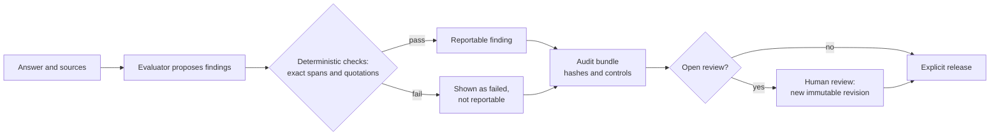

# Inspektorium

Fail-closed evidence integrity for AI-generated claims and AI evaluation reports.

[](https://github.com/LAKITALKS/Inspektorium/actions/workflows/ci.yml)
[](LICENSE)
[](pyproject.toml)
[](https://github.com/LAKITALKS/Inspektorium/releases/latest)

## Why

AI systems cite sources that do not exist or that say something else.
Evaluation reports can be manipulated by the very text they contain.
A reader then trusts a citation or a report line that nobody checked.
Inspektorium makes both visible and blocks by default.

It is for people who audit model answers or evaluation reports and need every reported finding to rest on evidence they can check.

## What it does

- **Exact citation binding.** Every quotation and claim span must match the supplied text exactly at its stated character offsets.
- **Fail-closed reportability.** A finding whose evidence fails a check is not reportable; the report shows the failure instead.
- **Tamper-resistant report display.** Untrusted text cannot forge report lines, hide warnings or inject markup.
- **Audit workflow with human review.** Hash-bound bundles, recorded human decisions and an explicit release step.



Evaluators, human or model, *propose* relations between claims and sources.
Inspektorium does not decide whether a claim is true; it checks the evidence pointers and gates the report on them.
See [how it works](docs/concepts/how-it-works.md).

## Quickstart

<!-- quickstart:start -->
Install the release into a fresh virtual environment (Python 3.11 or newer):

```bash
python3 -m venv .venv
. .venv/bin/activate
python -m pip install "https://github.com/LAKITALKS/Inspektorium/releases/download/v0.3.0/inspektorium-0.3.0-py3-none-any.whl"
```

Check one answer against its source. The example contains a fabricated quotation:

```bash
EXAMPLE=https://raw.githubusercontent.com/LAKITALKS/Inspektorium/v0.3.0/examples
curl -fsSLO "$EXAMPLE/inspect/05_mixed_and_fabricated_quote/input.json"
curl -fsSLO "$EXAMPLE/inspect/05_mixed_and_fabricated_quote/proposals.json"
inspektorium inspect --input input.json --proposals proposals.json --format markdown
```

Run one recorded case through the audit workflow and release it explicitly:

```bash
curl -fsSLO "$EXAMPLE/audit/positive-task.json"
curl -fsSLO "$EXAMPLE/audit/positive-recording.json"
inspektorium audit validate --task positive-task.json
inspektorium audit run --offline --task positive-task.json \
  --recording positive-recording.json --output-root bundles > run.json
CANDIDATE=$(python -c 'import json; print(json.load(open("run.json"))["path"])')
inspektorium audit inspect --bundle "$CANDIDATE"
inspektorium audit release --bundle "$CANDIDATE" --output-root bundles \
  --reviewer "Local operator" --reason "Release of a synthetic example"
```
<!-- quickstart:end -->

The `inspect` report keeps the valid findings and shows the fabricated quotation as failed (excerpt):

```text
- Claims inspected: 3
- Relationships allowed to remain reportable: 2
- Citations with an exact text and offset match: 1
- Deterministic validation failures: 1
...
- **Reportable proposed relationship:** None — deterministic guard failed
- **Citation text and offset check:** no exact match
```

The audit steps print JSON. `run` reports `"status": "READY_FOR_RELEASE"`, and `release` reports `"status": "RELEASED"`.
An unresolved case stops at `REVIEW_REQUIRED` with exit code 2, and its release is refused.
The [getting-started guide](docs/getting-started.md) walks through both workflows, including review.

## What it is not

- **Not a truth check.** An exact quotation can still be quoted out of context, and a released audit result is not scientific truth.
- **Not a hallucination score.** There is no global score or answer-level label.
- **Not yet shown to work scientifically.** An owner-reported pilot found no accuracy difference between its prompt conditions. This null result sits at a ceiling; see [results](docs/research/results.md#outcomes-including-the-null-result).

All limits are listed once, in [limitations](docs/evaluation/limitations.md).

## Status and evidence

| Area | Status | Evidence |
| --- | --- | --- |
| Reference checker (`inspect`) | Implemented; report schema 0.1 | [Evidence package v0.1.1](evidence/v0.1.1/README.md) |
| Report display hardening | Implemented; counter-tested | [Display addenda](docs/evaluation/evidence.md) |
| Audit workflow (`audit`) | Implemented offline; frozen acceptance | [Evidence and CI](docs/evaluation/evidence.md) |
| Live model runs | Limited historical checks on earlier code | [Results](docs/research/results.md) |
| Scientific efficacy | Not established; pilot null result | [Research plan](docs/research/plan.md) |

## How it relates to other tools

Inspektorium is not a better judge. It is an integrity layer for the evidence and reports that judges produce.

| Tool | What it does | Difference |
| --- | --- | --- |
| [Anthropic Citations API](https://platform.claude.com/docs/en/build-with-claude/citations) | The model returns cited text with character locations in supplied documents | Pointers come from the provider during generation; Inspektorium checks evaluator pointers afterwards |
| [verbatimeter](https://pypi.org/project/verbatimeter/) | Measures verbatim reuse offline; `--quotes --fail` fails a run on a differing quotation | Checks quotations token by token; no binding to stated offsets and no per-finding reportability |
| [anchor](https://github.com/hnvivek/anchor) | Grounding gate with NLI and an optional LLM judge; emits offsets | Decides support with a model; Inspektorium decides no support |
| [LettuceDetect](https://github.com/KRLabsOrg/LettuceDetect) | Predicts hallucinated character spans with a classifier | Predicts spans; Inspektorium verifies given spans |
| [RAGAS faithfulness](https://docs.ragas.io/en/stable/concepts/metrics/available_metrics/faithfulness/) | LLM-judged share of supported statements | A model-based score; Inspektorium produces no score |
| [garak `ansiescape`](https://github.com/NVIDIA/garak/blob/main/garak/probes/ansiescape.py) | Probes whether a model emits terminal escape codes | Probes the model; Inspektorium neutralizes such text in reports |
| [Inspect](https://github.com/UKGovernmentBEIS/inspect_ai) | General framework for LLM evaluations | A harness; Inspektorium checks the evidence and reports it produces |

[TruLens](https://github.com/truera/trulens), RefChecker and MiniCheck are model-based groundedness scorers like RAGAS; the [paper draft](paper/paper.md) compares them.

## Documentation

- [Documentation index](docs/index.md): getting started, concepts, guides and reference.
- Research: [plan](docs/research/plan.md), [results with the null result](docs/research/results.md), [claim ledger](docs/research/claims.md) and [history](docs/research/history.md).
- [Roadmap](docs/roadmap.md): proposed milestones, subject to funding.
- [Contributing](CONTRIBUTING.md), [security policy](SECURITY.md) and [code of conduct](CODE_OF_CONDUCT.md).

## Cite, license and author

Cite Inspektorium with the metadata in [CITATION.cff](CITATION.cff).
Licensed under the [Apache License 2.0](LICENSE); third-party material keeps its own rights, see [NOTICE](NOTICE).
Author: Lazaros Varvatis, Independent Researcher, Berlin.

Developed with AI-assisted implementation and review under the author's direction; see [docs/development/ai-assistance.md](docs/development/ai-assistance.md).
