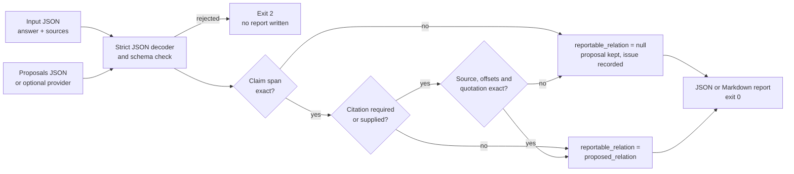
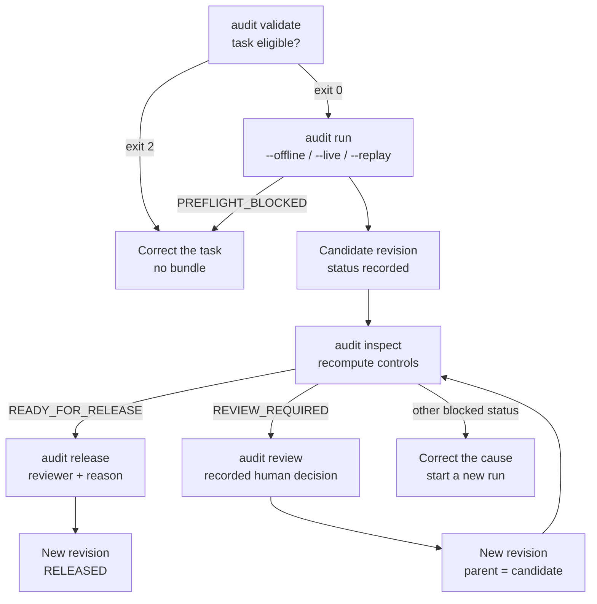
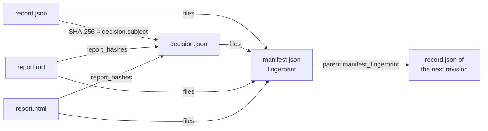

# How it works

Inspektorium separates what a model proposes from what code can check.
It ships one command, `inspektorium`, with two subcommands that use separate pipelines.

| Subcommand | Package | Unit of work | Result |
| --- | --- | --- | --- |
| `inspektorium inspect` | `inspektorium.core`, `inspektorium.report`, `inspektorium.providers` | One answer, its supplied sources and proposed findings | One JSON or Markdown report, schema 0.1 |
| `inspektorium audit` | `inspektorium.audit` | One task and one recorded or authorized model response | Immutable bundle revisions with explicit release |

Audit does not call the reference checker, and the reference checker has no review or release step.
The detailed contracts are in [methodology](methodology.md). Attacks in and out of scope are in the [threat model](threat-model.md).
What the results do not establish is listed once in [limitations](../evaluation/limitations.md).

## Proposal versus deterministic check

An evaluator, usually a language model, proposes findings. A proposal names a claim, a relation and a citation.
Inspektorium preserves the proposal unchanged. Deterministic code then checks its text bindings.

The reference checker checks four things for each proposal ([validation](../../src/inspektorium/core/validation.py)):

1. The claim text equals the answer at the proposed span.
2. The named source exists in the supplied input.
3. The evidence offsets lie inside the source and match the quotation length.
4. The source text at those offsets equals the quotation exactly.

Nothing is searched for, moved or repaired. A proposal of `not_established` may carry no citation at all.
The relation itself stays an evaluator judgment. Code does not decide whether it is true.

## Fail-closed reportability

"Fail-closed" applies to one field per finding: `reportable_relation`.
If a mandatory check fails, that field is null and a finite issue code explains why.
The proposal, its quotation and its offsets stay visible in the report.
Other findings and the rest of the report are unaffected.

The report counts findings mechanically. It has no score, rank or answer-level verdict.
[Report schema](../reference/report-schema.md#inspect-report-schema-01) lists every field.

## The audit bundle

The audit workflow processes one task: an original claim plus its source context.
A run sends the task to a provider and analyses the response. Offline, the provider is a recorded response file.
The analysis covers parsing, source binding, semantic and taxonomy checks, and review history.
Each control has a fixed version in a registry ([pipeline](../../src/inspektorium/audit/workflow/pipeline.py)).

The run writes a **candidate**: a directory with exactly the five files listed in [`FILES`](../../src/inspektorium/audit/workflow/models.py).

| File | Content |
| --- | --- |
| `record.json` | Revision identity, status, the complete run record with raw response, and bound provenance |
| `decision.json` | Every control result, the report hashes and any release intent |
| `manifest.json` | Status, provenance, the SHA-256 of the other four files and its own fingerprint |
| `report.md` | Deterministic Markdown report |
| `report.html` | Equivalent escaped HTML report |

A bundle is never edited. Every later step writes a new revision directory and links its parent.

### Status

Each revision records one operational status.
The status names are fixed in [workflow models](../../src/inspektorium/audit/workflow/models.py).

| Status | Meaning |
| --- | --- |
| `PREFLIGHT_BLOCKED` | The task or offline provider selection is not eligible |
| `RUN_FAILED` | The run ended without usable output |
| `ANALYSIS_INCOMPLETE` | The output could not be bound to the source |
| `REVIEW_REQUIRED` | A mandatory review is open; only a recorded human decision or a new run continues |
| `RELEASE_BLOCKED` | An integrity, control or render check failed |
| `READY_FOR_RELEASE` | All controls passed; an explicit release is still required |
| `RELEASED` | These exact local artifact bytes passed the current controls and an explicit release intent |

### Fingerprint chain

All JSON files are written as canonical JSON: sorted keys, no optional spaces, UTF-8 and one final newline.
Hashes are SHA-256 over those bytes.

The reports also show the record fingerprint.
The manifest binds the installed audit-runtime module bytes in `provenance.code`.
[Report schema](../reference/report-schema.md#audit-bundle-files) describes each field.

## Inspection

`audit inspect` makes no provider call. It reloads the five files and rejects duplicate JSON keys.
It checks the file hashes, the manifest fingerprint and the decision subject against the stored bytes.
It then recomputes all controls from the raw-bound history under the installed code.
The stored decision must equal that recomputation.

A changed byte makes the bundle invalid. `inspect` then returns `"valid": false` and exits 2.
An intact bundle returns `"valid": true` and exits 0, whatever its recorded status.

## Human review

A `REVIEW_REQUIRED` revision stays as it is. No reviewer or review queue is assumed.
`audit review` appends one human decision to the review history:

- `--select` names a position from the recorded review history;
- `--reviewer` and `--reason` are recorded provenance;
- `--correction` optionally supplies a corrected response file.

The workflow re-runs every control on the extended history and writes a new revision.
A selection that would waive a failed control is rejected with `REVIEW_REQUIRED` and no new revision.
The review state directory (`--state-dir`) keeps case history and locks between calls.

## Explicit release

`audit release` accepts only a valid `READY_FOR_RELEASE` revision.
It rechecks that revision, adds a release intent with reviewer, reason and the scope `local_artifact_only`, and writes a new revision with status `RELEASED`.
The candidate bytes stay unchanged. There is no option to force a release.

A run never releases by itself. Exit code 0 from `run` means `READY_FOR_RELEASE`, not `RELEASED`.

## Execution modes

`audit run` takes exactly one mode:

| Mode | Provider | Network |
| --- | --- | --- |
| `--offline` | A recorded response file (`--recording`) | None |
| `--live` | The live Anthropic adapter under an authorization directory and profile | Yes |
| `--replay` | Captured responses from an earlier live run | None |

Offline mode accepts only the built-in recording provider and never falls back to a network call.
Live and replay controls are described in [methodology](methodology.md#controls).

## Where to go next

- [Getting started](../getting-started.md) runs both subcommands once.
- [Reference-checker guide](../guides/reference-checker.md) and [audit workflow guide](../guides/audit-workflow.md).
- [Limitations](../evaluation/limitations.md) and [threat model](threat-model.md).
- Earlier releases and naming are covered in [history](../research/history.md).
