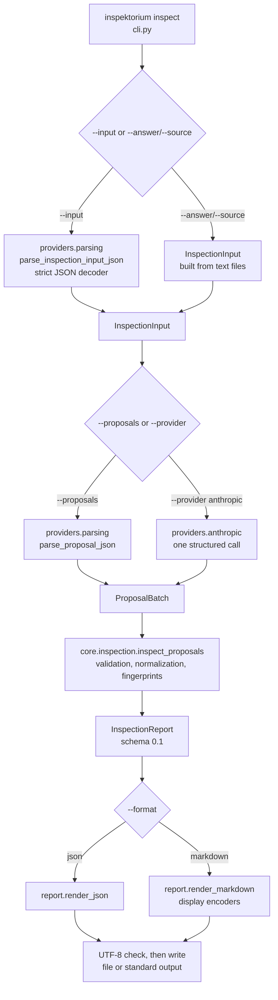
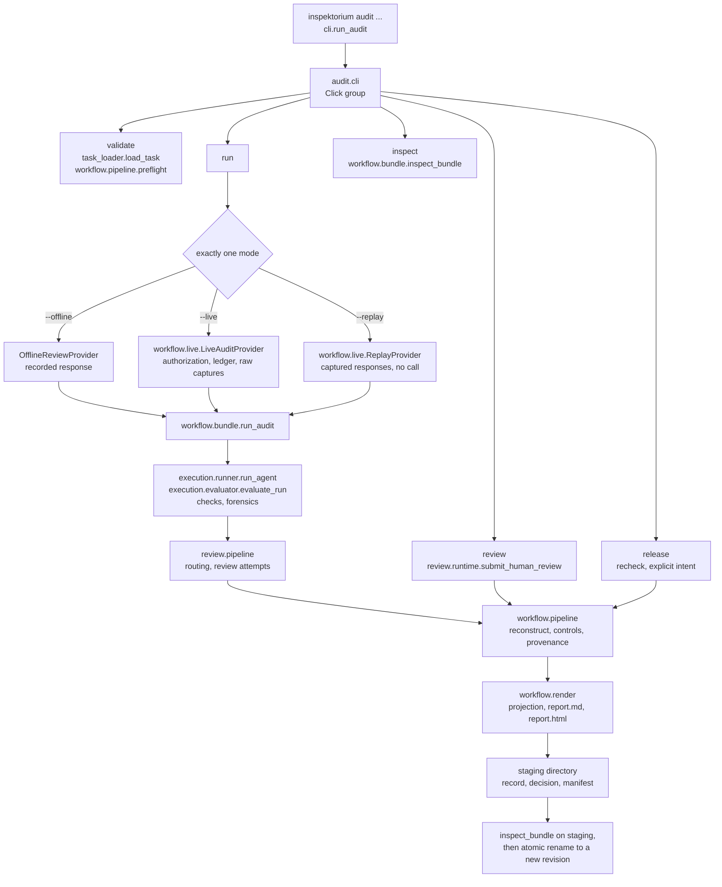

# Architecture

Inspektorium 0.3.0 is one Python distribution, `inspektorium`, with one command, `inspektorium`.
The command has two pipelines that share no validation code: `inspect` and `audit`.
This page maps the packages, shows how data flows through each pipeline and explains how audit bundles bind code.
Concepts are explained in [how it works](../concepts/how-it-works.md). Limits are listed in [limitations](../evaluation/limitations.md).

## Package overview

```text
src/inspektorium/
├── __init__.py        public reference API and __version__
├── __main__.py        python -m inspektorium
├── cli.py             the inspektorium command: inspect, and lazy dispatch to audit
├── core/              reference checker kernel: models, validation, normalization, fingerprints
├── report/            reference checker JSON and Markdown rendering, display encoders
├── providers/         reference checker provider boundary and strict parsing
└── audit/             audit runtime
    ├── cli.py         the audit command group: validate, run, inspect, review, release
    ├── schemas.py     task, run record and result models
    ├── workflow/      bundle, live, models, pipeline, projection, render
    ├── forensics/     models, pipeline, semantics, taxonomy, forensic_report
    ├── review/        adjudication, models, pipeline, routing, runtime
    ├── execution/     runner, evaluator, task_loader
    ├── integrity/     artifact_binding, audit_trail, output_contract, budget_ledger
    ├── checks/        claim_checker, consistency, forecast_checker, reasoning_graph,
    │                  step_checker, study_forensics_checker, confidence_validity
    └── providers/     provider base, live adapter and SDK adapters
```

### Reference checker

| Module | Role |
| --- | --- |
| [`core/`](../../src/inspektorium/core/) | Strict models, the four relations, NFC/LF normalization, span validation, SHA-256 fingerprints, the strict JSON decoder and `inspect_proposals` |
| [`report/`](../../src/inspektorium/report/) | Deterministic JSON rendering, Markdown rendering and the display encoders for untrusted text |
| [`providers/`](../../src/inspektorium/providers/) | The provider protocol, strict parsing of `--input` and proposal JSON, and the optional Anthropic adapter |
| [`cli.py`](../../src/inspektorium/cli.py) | Argument parsing, the `inspect` flow and the lazy `audit` dispatch |

`core/` and `report/` are byte-identical to release 0.2.0.
The [evidence page](../evaluation/evidence.md#relation-to-030) explains why that matters.

### Audit runtime

| Subpackage | Role |
| --- | --- |
| [`audit/cli.py`](../../src/inspektorium/audit/cli.py) | Click group with the five operations and their exit codes |
| [`workflow/`](../../src/inspektorium/audit/workflow/) | Preflight, controls, provenance, bundle writing and inspection, live and replay sessions, deterministic projection and rendering |
| [`forensics/`](../../src/inspektorium/audit/forensics/) | Semantic and inferential analysis of the recorded answer and its taxonomy |
| [`review/`](../../src/inspektorium/audit/review/) | Disagreement routing, bounded review attempts and human or model adjudication |
| [`execution/`](../../src/inspektorium/audit/execution/) | Task loading, one agent run against one provider, and evaluation of the run |
| [`integrity/`](../../src/inspektorium/audit/integrity/) | Artifact-binding gates, structured-output parsing, the audit trail and the durable budget ledger |
| [`checks/`](../../src/inspektorium/audit/checks/) | Deterministic checks on claims, consistency, forecasts, reasoning graphs, steps, study forensics and confidence values |
| [`providers/`](../../src/inspektorium/audit/providers/) | `BaseProvider`, the live Anthropic adapter with its registered profiles, and SDK adapters |
| [`schemas.py`](../../src/inspektorium/audit/schemas.py) | `Task`, `RunRecord`, `AgentResult` and related models |

No `inspektorium` command loads the provider adapters `providers/anthropic.py`, `providers/openai.py` and `providers/ollama.py`.
`providers.get_provider` loads them on request through the Python API; they make live calls without an audit authorization ([limitations](../evaluation/limitations.md#audit-workflow-inspektorium-audit)).
Other modules that no command loads moved to the research record with their tests ([migration](migration-0.3.md#python-imports)).
The audit commands pass provider objects directly. They never resolve a provider by name.

## Data flow: `inspektorium inspect`



The input file and `--generated-at` are validated before proposals load or a provider is constructed.
Nothing is written until rendering succeeds and the text encodes as UTF-8.
Parse errors exit 2. A report with failed citations exits 0.

## Data flow: `inspektorium audit`

`inspektorium.cli.main` hands every argument after `audit` to `run_audit`.
`run_audit` imports `inspektorium.audit.cli` lazily, so `inspect` and `--help` never load the runtime.



- Live runs route to a counterreview only when the review route recommends it.
- `review` and `release` first inspect the parent bundle. Each writes a new revision that links its parent's manifest fingerprint.
- `release` accepts only a current `READY_FOR_RELEASE` candidate. The candidate bytes stay unchanged.
- A revision directory is renamed into place only after the staged bundle passes inspection. An existing revision is never overwritten.

## Code binding

Audit bundles bind the bytes of the installed audit runtime.
`audit inspect` recomputes the binding under the code that is installed now.

### Runtime code identity

[`inspektorium.audit.workflow.pipeline.code_identity()`](../../src/inspektorium/audit/workflow/pipeline.py) computes the identity:

1. It locates the runtime package from `inspektorium.audit.__file__`.
2. It reads every `*.py` file below that directory, recursively, in sorted order.
3. It hashes each file's bytes with SHA-256, keyed by its path relative to the package.
4. The `code_fingerprint` is the SHA-256 of the canonical JSON of that map.
5. It records a `verified_source_commit` only if `git` reports a commit whose tracked `*.py` blobs match every installed file.
   Otherwise `source_binding` says "installed bytes only".

The provenance block of each bundle stores this identity with the installed `inspektorium` version.
On inspection, the provenance control passes only if the recomputed provenance equals the bound one.
A bound source-commit claim must also still verify against Git.

Any change to any runtime `*.py` file changes the fingerprint.
This includes the provider adapters, which no command loads.
Files outside `inspektorium/audit/`, such as `core/` or `cli.py`, are not part of this identity.

### Review code version

[`inspektorium.audit.review.runtime.code_version()`](../../src/inspektorium/audit/review/runtime.py) hashes the explicit tuple `REVIEW_MODULES`.
The tuple names `adjudication.py`, `models.py`, `pipeline.py`, `routing.py` and `runtime.py` in `review/`.
The result is written into denied or rejected review attempts and into every model or human adjudication record.
These records are part of the run record, which the bundle binds.

### Consequences

- An earlier bundle verifies only under the code that produced it.
- Bundles from releases before 0.3.0 bind a different package path and different bytes. 0.3.0 reports them as invalid.
- [Reproducibility](../evaluation/reproducibility.md#historical-evidence) explains how to check them with their own release.
- Fingerprints are hashes, not signatures ([limitations](../evaluation/limitations.md#audit-workflow-inspektorium-audit)).
